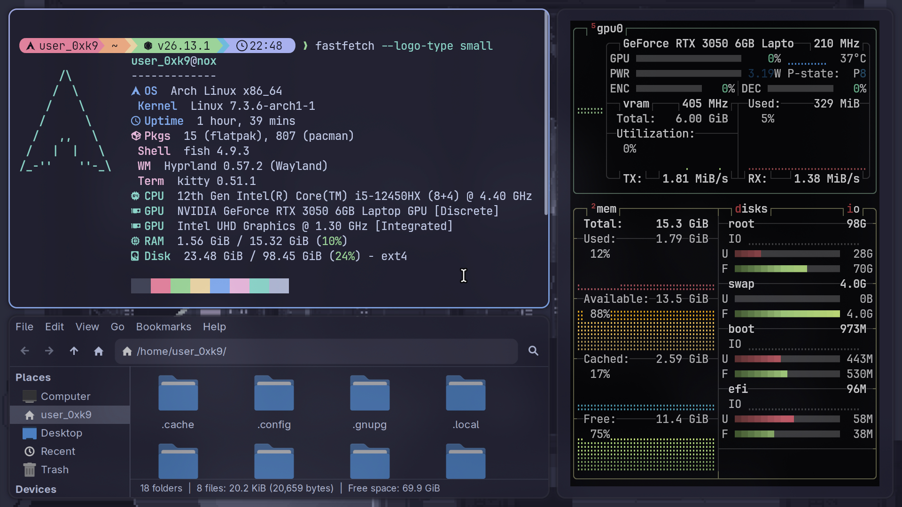

# 🐈‍⬛ MyHyprDotfiles

**Arch Linux · Hyprland (Lua-конфиг) · Catppuccin Mocha / Lavender**

Тёмный, слегка прозрачный и размытый рабочий стол: не минимализм, но и не максимализм.




---

## ✨ Что внутри

| Компонент | Что используется |
|---|---|
| Композитор | Hyprland (конфиг на Lua, нужна версия 0.55+) |
| Панель | Waybar: отдельные «таблетки», кофейная чашка, трек из плеера |
| Лаунчер | rofi |
| Уведомления | swaync |
| Выход из сессии | wlogout |
| Блокировка / простой | hyprlock, hypridle |
| Обои | hyprpaper (смена на `SUPER + W`) |
| Терминал | kitty + fish + starship + fastfetch |
| GTK | adw-gtk3-dark, покрашена в палитру Mocha |
| Иконки / шрифт | Papirus-Dark / JetBrainsMono Nerd Font |
| Экран входа | SDDM, тема `catppuccin-mocha-lavender` (вне репозитория) |

## ⌨️ Основные клавиши

`SUPER` это клавиша Windows.

| Сочетание | Действие |
|---|---|
| `SUPER + Enter` | терминал |
| `SUPER + D` | лаунчер (rofi) |
| `SUPER + E` | файловый менеджер |
| `SUPER + B` | Firefox |
| `SUPER + Q` | закрыть окно |
| `SUPER + F` | полный экран |
| `SUPER + V` | плавающее окно |
| `SUPER + J` | перевернуть раскладку пары окон |
| `SUPER + ~` | выпадающий терминал |
| `SUPER + 1…0` | воркспейсы |
| `SUPER + SHIFT + 1…0` | перенести окно на воркспейс |
| `SUPER + ЛКМ / ПКМ` | двигать / менять размер окна |
| `SUPER + L` | блокировка |
| `SUPER + SHIFT + E` | меню выключения |
| `SUPER + N` | центр уведомлений |
| `SUPER + SHIFT + S` | скриншот области (grim + slurp + satty) |
| `SUPER + SHIFT + C` | пипетка цвета |
| `SUPER + .` | история буфера обмена |
| `SUPER + W` | сменить обои |
| `SUPER + SHIFT + N` | ночной режим (hyprsunset) |
| `CapsLock` | смена раскладки us / ru |

В терминале: `clear` очищает экран и показывает fastfetch, `clear -n` очищает без него,
`rebar` перезапускает Waybar.

## 📦 Установка

> Конфиг написан на Lua, нужен **Hyprland 0.55 или новее**.
> Пример рассчитан на Arch Linux.

**1. Пакеты**

```bash
sudo pacman -S --needed hyprland waybar kitty thunar gvfs tumbler hyprpaper \
  hyprlock hypridle hyprpolkitagent hyprpicker hyprsunset swaync rofi wlogout \
  xdg-desktop-portal xdg-desktop-portal-hyprland xdg-desktop-portal-gtk \
  grim slurp satty wl-clipboard cliphist brightnessctl playerctl pavucontrol \
  bluez bluez-utils blueman networkmanager power-profiles-daemon \
  noto-fonts noto-fonts-emoji ttf-jetbrains-mono-nerd ttf-font-awesome \
  qt5-wayland qt6-wayland nwg-look adw-gtk-theme papirus-icon-theme \
  fish starship fastfetch btop eza zoxide bat fzf fd ripgrep git
```

**2. Копия твоих настроек и установка**

```bash
git clone https://github.com/user0xk9/MyHyprDotfiles ~/MyHyprDotfiles
cp -r ~/.config ~/.config.backup
cp -r ~/MyHyprDotfiles/{hypr,waybar,rofi,swaync,wlogout,kitty,fastfetch,fish,btop,gtk-3.0,gtk-4.0,starship.toml} ~/.config/
```

Вторая команда сохраняет твои текущие настройки на случай отката.

**3. Обои**

Положи картинки в `~/Pictures/wallpapers` и укажи свою в `~/.config/hypr/hyprpaper.conf`
(параметр `path`). Обои в репозиторий не входят.

**4. Оболочка**

kitty запускает fish (строка `shell` в `kitty/kitty.conf`). Если fish не нужен,
удали эту строку, и терминал откроет обычную оболочку.

## 🎨 Как поменять палитру

Цвета лежат в нескольких местах, меняются заменой файлов:

| Файл | Для чего |
|---|---|
| `hypr/modules/colors.lua` | рамки окон, тени |
| `hypr/colors.conf` | hyprlock |
| `waybar/colors.css` | панель |
| `rofi/colors.rasi`, `swaync/style.css`, `gtk-3.0/gtk.css`, `gtk-4.0/gtk.css` | лаунчер, уведомления, GTK |

## 🗂 Структура

```
hypr/
├── hyprland.lua          точка входа
├── modules/              env, input, appearance, rules, autostart, keybinds, colors
├── hyprlock.conf  hypridle.conf  hyprpaper.conf  colors.conf
└── scripts/wallpaper.sh  выбор обоев через rofi
waybar/  rofi/  swaync/  wlogout/  kitty/  fastfetch/  fish/  btop/  gtk-3.0/  gtk-4.0/
```

## ⚠️ Что не входит в репозиторий

- обои;
- тема SDDM (`/usr/share/sddm/themes/`);
- политики и `user.js` для Firefox;
- пакеты и системные настройки.

## 🙏 Благодарности

[Catppuccin](https://github.com/catppuccin) за палитру, команда
[Hyprland](https://github.com/hyprwm/Hyprland) и авторы всех используемых утилит.
